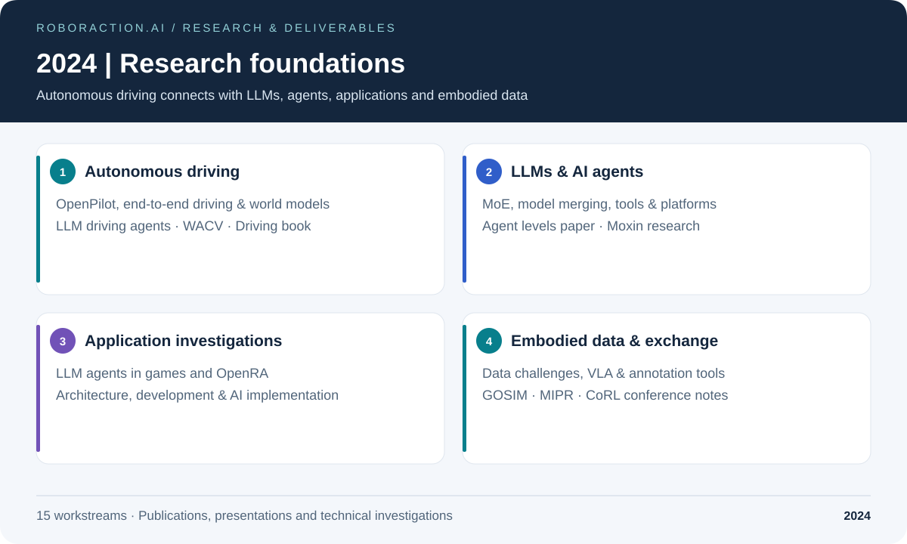

# 2024 · Work Report

[首页 / Home](README.md) · [2024](2024%20Work%20Summary.md) · [2025](2025%20Work%20Summary.md) · [2026](2026%20Work%20Summary.md)

> Autonomous driving · LLMs & AI agents · Embodied data

## At a glance · 工作概览

| 方向 / Focus | 工作内容 / Scope |
| :--- | :--- |
| 自动驾驶 | OpenPilot、数据集、传感器融合与专著 |
| 大模型与智能体 | MoE、工具调用、智能体分级与 Moxin |
| 应用与交流 | OpenRA、具身数据、标注工具与会议分享 |

## Contents · 导航

[English summary](#summary) · [中文概述](#概述) · [交付清单](#deliverables--交付清单)

查看全部 15 个工作条目 / Browse workstreams

- [1. LLVM-AD, IEEE WACV’24 (Winter Conference on Applications of Computer Vision)](#deliverable-1)
- [2. Work with OpenPilot](#deliverable-2)
- [3. 黄浴，杨子江，《自动驾驶系统开发》，清华大学出版社，2024年5月](#deliverable-3)
- [4. Work on Autonomous Driving](#deliverable-4)
- [5. Investigation of MOE](#deliverable-5)
- [6. Investigation of Agent Tool Use / Function Calling](#deliverable-6)
- [7. Investigation of AI Platform with LLM](#deliverable-7)
- [8. Levels of AI Agents: From Rules to Large Language Models, arXiv 2405.06643, 2024](#deliverable-8)
- [9. Industry Forum “The Age of Industrial AI Agents: Opportunities & Challenges”, IEEE MIPR’ 2024](#deliverable-9)
- [10. Investigation of LLM Application in Games](#deliverable-10)
- [11. LLM Application for OpenRA, I.e. Red Alert](#deliverable-11)
- [12. Data Issue in Embodied AI” (speech on GOSIM’24, Beijing)](#deliverable-12)
- [13. 7B Fully Open Source Moxin-LLM/VLM -- From Pretraining to GRPO-based Reinforcement Learning Enhancement, arXiv 2412.06845, 2024](#deliverable-13)
- [14. Annotation Tool](#deliverable-14)
- [15. CoRL’24 会议简记，Munich，Germany](#deliverable-15)

---

## Summary

The 2024 work connected autonomous driving research with an expanding focus on large language models, AI agents, and embodied intelligence. Autonomous driving deliverables included the WACV LLVM-AD keynote, the co-authored book *自动驾驶系统开发* (Autonomous Driving System Development), and technical studies of OpenPilot development and deployment pathways, dataset formats, depth-based driving, and sensor fusion. LLM and agent research covered mixture-of-experts models, model merging, tool use and function calling, agent architectures, application platforms, and AI devices, alongside the paper on levels of AI agents and contributions to the Moxin open-source language model research. Application-oriented investigations explored LLM agents in games and OpenRA, while embodied AI work examined data challenges, vision-language-action models, and annotation tools. Presentations and materials for WACV, MIPR, and GOSIM, together with CoRL conference notes, complemented the publications and technical reports. Collectively, these deliverables established a research and knowledge-sharing foundation spanning autonomous systems, agent capabilities, open-source AI, and the data requirements of embodied intelligence.

The autonomous driving investigations also examined end-to-end approaches, world models, and a two-part study of LLM-based driving agents.

## 概述

2024 年的工作将自动驾驶研究与大语言模型、AI 智能体（AI Agents）及具身智能（Embodied Intelligence）等日益受到关注的领域紧密结合。在自动驾驶方面，相关成果包括：在 WACV 会议上发表的“LLVM-AD”主题演讲；合著书籍《自动驾驶系统开发》；以及针对 OpenPilot 开发与部署路径、数据集格式、基于深度信息的驾驶技术，以及传感器融合技术所开展的各项研究。在大语言模型与智能体领域，研究涵盖了专家混合模型（MoE）、模型融合、工具使用与函数调用、智能体架构、应用平台及 AI 硬件设备；此外还包括关于 AI 智能体分级体系的论文，以及对“墨芯”（Moxin）开源语言模型研究的贡献。在应用导向的研究方面，团队探索了大语言模型智能体在游戏（如 OpenRA）中的应用；在具身智能领域，则重点探讨了数据挑战、视觉-语言-动作（VLA）模型以及标注工具。此外，在 WACV、MIPR 和 GOSIM 会议上的演讲与相关资料，以及 CoRL 会议的参会笔记，进一步丰富了上述研究成果与技术报告的内容。这些工作共同构建了一个涵盖自动驾驶系统、智能体能力、开源 AI 以及具身智能数据需求的研究与知识共享基础。

自动驾驶调研还补充了端到端方法、世界模型，以及两份基于 LLM 的自动驾驶智能体研究材料。

## Deliverables · 交付清单

### 1. LLVM-AD, IEEE WACV’24 (Winter Conference on Applications of Computer Vision)

- [Workshop website](https://llvm-ad.github.io/WACV_2024/)

- Keynote Speech “Large Scale Foundation Models for Autonomous Driving” — [PDF](2024doc/KeynoteSpeech-YuHuang-30mins.pdf)

### 2. Work with OpenPilot

- "OpenPilot开发途径" — [PPTX](2024doc/OpenPilot%E5%BC%80%E5%8F%91%E9%80%94%E5%BE%84.pptx)

- "OpenPilot的数据格式" — [PPTX](2024doc/OpenPilot%E7%9A%84%E6%95%B0%E6%8D%AE%E6%A0%BC%E5%BC%8F.pptx)

- "OpenPilot量产落地途径" — [PPTX](2024doc/OpenPilot%E9%87%8F%E4%BA%A7%E8%90%BD%E5%9C%B0%E9%80%94%E5%BE%84.pptx)

### 3. 黄浴，杨子江，《自动驾驶系统开发》，清华大学出版社，2024年5月

[Book · 清华大学出版社](https://www.tup.com.cn/booksCenter/book_10025801.html)

### 4. Work on Autonomous Driving

- "自动驾驶开源数据库的格式要求" — [PPTX](2024doc/%E8%87%AA%E5%8A%A8%E9%A9%BE%E9%A9%B6%E6%95%B0%E6%8D%AE%E5%BA%93%E6%A0%BC%E5%BC%8F.pptx)

- “Dataset for Autonomous Driving” — [PDF](2024doc/DatasetAD.pdf)

- “Depth image based self driving” — [PDF](2024doc/depth%20image%20based%20self%20driving.pdf)

- “数据层传感器融合” — [PDF](2024doc/%E6%95%B0%E6%8D%AE%E5%B1%82%E4%BC%A0%E6%84%9F%E5%99%A8%E8%9E%8D%E5%90%88.pdf)

- “端到端自动驾驶讨论” - [PDF](2024doc/%E7%AB%AF%E5%88%B0%E7%AB%AF%E8%87%AA%E5%8A%A8%E9%A9%BE%E9%A9%B6%E8%AE%A8%E8%AE%BA.pdf)

- “World Model for Autonomous Driving” - [PDF](2024doc/World%20Model%20for%20Autonomous%20Driving.pdf)

“LLM-based Agent for Autonomous Driving 1/2” PPT 

- LLM-based Agent for Autonomous Driving 1.pdf - [PDF](2024doc/LLM-based%20Agent%20for%20Autonomous%20Driving%201.pdf)

- LLM-based Agent for Autonomous Driving 2.pdf - [PDF](2024doc/LLM-based%20Agent%20for%20Autonomous%20Driving%202.pdf)

### 5. Investigation of MOE
   
- "LLM中的混合专家" — [PDF](2024doc/LLM%E4%B8%AD%E7%9A%84%E6%B7%B7%E5%90%88%E4%B8%93%E5%AE%B6.pdf)

- "最近LLM模型合并的方法" — [PDF](2024doc/%E6%9C%80%E8%BF%91LLM%E6%A8%A1%E5%9E%8B%E5%90%88%E5%B9%B6%E7%9A%84%E6%96%B9%E6%B3%95.pdf)

### 6. Investigation of Agent Tool Use / Function Calling

- "基于LLM的函数调用工具使用" — [PDF](2024doc/%E5%9F%BA%E4%BA%8ELLM%E7%9A%84%E5%87%BD%E6%95%B0%E8%B0%83%E7%94%A8%E5%B7%A5%E5%85%B7%E4%BD%BF%E7%94%A8.pdf)

### 7. Investigation of AI Platform with LLM

- “LLM智体方面的综述” — [PPTX](2024doc/LLM%E6%99%BA%E4%BD%93%E6%96%B9%E9%9D%A2%E7%9A%84%E7%BB%BC%E8%BF%B0.pptx)

- “LLM agent” — [PPTX](2024doc/LLM%20agent.pptx)

- “AIOS” — [PDF](2024doc/AIOS.pdf)

- “AI 终端设备” — [PDF](2024doc/AI%20%E7%BB%88%E7%AB%AF%E8%AE%BE%E5%A4%87.pdf)

- “LLM应用平台” — [PDF](2024doc/LLM%E5%BA%94%E7%94%A8%E5%B9%B3%E5%8F%B0.pdf)

### 8. Levels of AI Agents: From Rules to Large Language Models, arXiv 2405.06643, 2024

[Paper · arXiv](https://arxiv.org/abs/2405.06643)

知乎文章：["AI终端设备的自动化分级"](https://zhuanlan.zhihu.com/p/693978810)

Medium poster: ["**Automation Levels of AI Client Devices**"](https://yuhuang-63908.medium.com/automation-levels-of-ai-client-devices-b09e6ed3d47d)

### 9. Industry Forum “The Age of Industrial AI Agents: Opportunities & Challenges”, IEEE MIPR’ 2024

- [Conference website](https://sites.google.com/view/mipr2024/innovation-forums/innovation-forums-2)

- Talk PPT “Levels of AI Agent” — [PDF](2024doc/Yu-Huang_Levels%20of%20AI%20Agents.pdf)

### 10. Investigation of LLM Application in Games

“游戏-语言大模型-智体-1/2” PPT 

- [游戏-语言大模型-智体-1.pdf](2024doc/%E6%B8%B8%E6%88%8F-%E8%AF%AD%E8%A8%80%E5%A4%A7%E6%A8%A1%E5%9E%8B-%E6%99%BA%E4%BD%93-1.pdf)

- [游戏-语言大模型-智体-2.pdf](2024doc/%E6%B8%B8%E6%88%8F-%E8%AF%AD%E8%A8%80%E5%A4%A7%E6%A8%A1%E5%9E%8B-%E6%99%BA%E4%BD%93-2.pdf)

### 11. LLM Application for OpenRA, I.e. Red Alert

- “openRA介绍” — [PDF](2024doc/openRA%E4%BB%8B%E7%BB%8D.pdf)

- “openRA开发” — [PDF](2024doc/openRA%E5%BC%80%E5%8F%91.pdf)

- “openRA AI Implementation” — [PDF](2024doc/openRA%20AI%20Implementation.pdf)

- “OpenRA大语言模型智体” — [PDF](2024doc/OpenRA%E5%A4%A7%E8%AF%AD%E8%A8%80%E6%A8%A1%E5%9E%8B%E6%99%BA%E4%BD%93.pdf)

- 知乎文章：["开源跨平台实时战略游戏引擎OpenRA"](https://zhuanlan.zhihu.com/p/682233241)

### 12. Data Issue in Embodied AI” (speech on GOSIM’24, Beijing)

- “具身智能讨论” — [PDF](2024doc/%E5%85%B7%E8%BA%AB%E6%99%BA%E8%83%BD%E8%AE%A8%E8%AE%BA.pdf)

- “Data Issues in Embodied AI” — [PDF](2024doc/Data%20Issues%20in%20Embodied%20AI.pdf)

- 知乎文章： [“具身智能行为学习需要什么数据？”](https://zhuanlan.zhihu.com/p/11365579054)

- Medium Poster ["What Data Imperative for Action Learning in Embodied AI? (1)"](https://yuhuang-63908.medium.com/what-data-imperative-for-action-learning-in-embodied-ai-1-5b8cf948c0a4)

- Medium Poster ["What Data Imperative for Action Learning in Embodied AI? (2)"](https://yuhuang-63908.medium.com/what-data-imperative-for-action-learning-in-embodied-ai-2-882c4ade2e7d)

- “GOSIM_China_2024_EmbodiedAI-VLA-YH” (English version) — [PDF](2024doc/GOSIM_China_2024_EmbodiedAI-VLA-YH.pdf)

- “GOSIM_China_2024_EmbodiedAI-VLA-YuHuang” (Chinese version) — [PDF](2024doc/GOSIM_China_2024_EmbodiedAI-VLA-YuHuang.pdf)

### 13. “7B Fully Open Source Moxin-LLM/VLM -- From Pretraining to GRPO-based Reinforcement Learning Enhancement”, arXiv 2412.06845, 2024

[Paper · arXiv](https://arxiv.org/abs/2412.06845)

### 14. Annotation Tool

- “Data Annotation” — [PDF](2024doc/Data%20Annotation.pdf)

- “大模型标注工具” — [PDF](2024doc/%E5%A4%A7%E6%A8%A1%E5%9E%8B%E6%A0%87%E6%B3%A8%E5%B7%A5%E5%85%B7.pdf)

### 15. CoRL’24 会议简记，Munich，Germany

- [CoRL’24 会议简记.docx](2024doc/CoRL%E2%80%9924%20%E4%BC%9A%E8%AE%AE%E7%AE%80%E8%AE%B0.docx)

- [知乎文章](https://zhuanlan.zhihu.com/p/7649884788)

---

[↑ Back to top](#2024--work-report) · [首页 / Home](README.md) · [2024](2024%20Work%20Summary.md) · [2025](2025%20Work%20Summary.md) · [2026](2026%20Work%20Summary.md)
