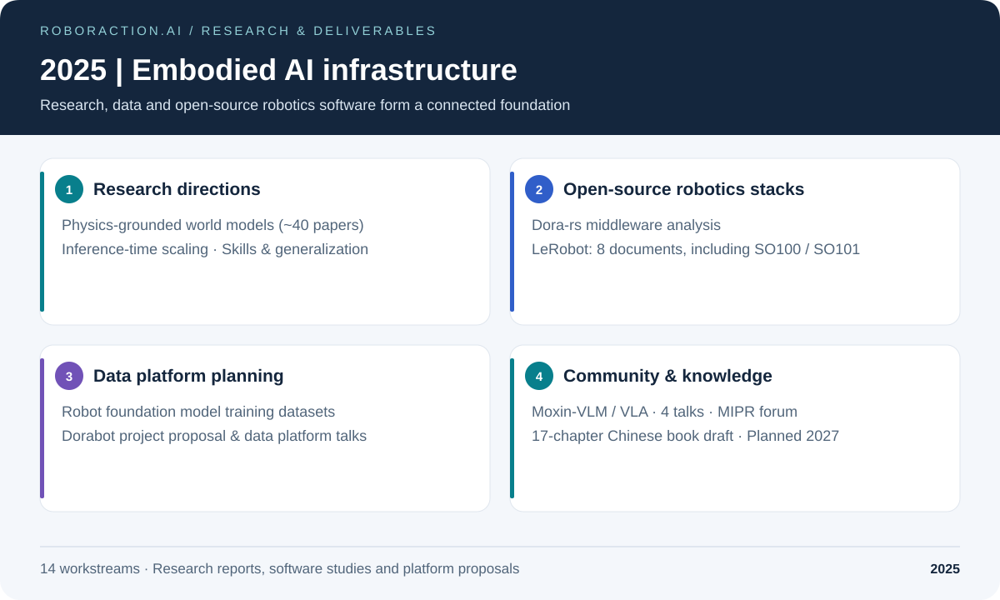

# 2025 · Work Report

[首页 / Home](README.md) · [2024](2024%20Work%20Summary.md) · [2025](2025%20Work%20Summary.md) · [2026](2026%20Work%20Summary.md)

> World models · Robotics software · Data infrastructure

## At a glance · 工作概览

| 方向 / Focus | 工作内容 / Scope |
| :--- | :--- |
| 研究 | 物理规律世界模型、推理规模化、技能学习与泛化 |
| 软件与数据 | Dora-rs、LeRobot、Dorabot 提案与机器人训练数据 |
| 知识传播 | 四场演讲、MIPR 论坛与 17 章书稿 |

## Contents · 导航

[English summary](#summary) · [中文概述](#概述) · [交付清单](#deliverables--交付清单)

查看全部 14 个工作条目 / Browse workstreams

- [1. Investigation of World model with physical law (summary reports for about 40 papers);](#deliverable-1)
- [2. Investigation of LLM Scaling Law](#deliverable-2)
- [3. Investigation of Embodied AI](#deliverable-3)
- [4. Keynote Speech at OS2ATC' 2025, Beijing](#deliverable-4)
- [5. Report of data construction for robot model training (based on NV GR00T work);](#deliverable-5)
- [6. talk for session "embodied AI" at conference of Open Atomic Foundation, Changsha, Hunan prov.](#deliverable-6)
- [7. Dorobot project proposal](#deliverable-7)
- [8. Dora-rs analysis and report;](#deliverable-8)
- [9. Talk for session "embodied AI" at conference of Open Atomic Foundation, Chongqing;](#deliverable-9)
- [10. Talk at Conference Kaiyuanshe Coscon'25, Beijing;](#deliverable-10)
- [11. Organized industry innovation forum at IEEE MIPR'25, San Jose;](#deliverable-11)
- [12. Drafted version of the book 《具身智能-从模块化结构到端到端模型》 in Chinese （Electronic Industry Press)](#deliverable-12)
- [13. Introduction of Hugging face‘s LeRobot](#deliverable-13)
- [14. “Open-Source Multimodal Moxin Models with Moxin-VLM and Moxin-VLA”, arXiv 2512.22208](#deliverable-14)

---

## Summary

In 2025, the work built the research, data and middleware foundation for embodied AI, and established a public presence for it in the open-source and research communities.

Research investigations covered three directions: physics-grounded world models (about 40 papers), inference-time scaling laws for large language models, and embodied AI itself, with studies of robot skill learning methods and of generalization in robot policy learning. On the engineering side, the work analyzed two open-source robotics stacks: the Dora-rs middleware, and Hugging Face’s LeRobot, documented in an eight-part series covering its dataset management, robot control, environment interface and policy systems, a development guide, and hands-on setup of the SO100 and SO101 arms. This fed into a project proposal for the Dorabot embodied AI data platform and a report on dataset construction for robot foundation model training based on NVIDIA’s GR00T work.

The results were presented in four talks: a keynote at OS2ATC’25 in Beijing, the Open Atom Foundation conferences in Changsha and Chongqing, and COSCon’25 in Beijing. An industry innovation forum on embodied AI was also organized at IEEE MIPR’25 in San Jose, and a 17-chapter book on embodied AI was drafted for publication in 2027.

The publication portfolio also included Open-Source Multimodal Moxin Models with Moxin-VLM and Moxin-VLA, connecting the software and data investigations with open-source multimodal model research.

## 概述

2025年，工作围绕具身智能（Embodied AI）的研究、数据与中间件基础展开，并在开源及学术研究社区中推广这些成果。

调研工作涵盖三个方向：基于物理规律的世界模型（约40篇论文）、大模型推理时间的规模化定律，以及具身智能本身，包括机器人技能学习方法和机器人策略学习的泛化方法。工程方面，分析了两套开源机器人软件栈：Dora-rs中间件，以及Hugging Face的LeRobot。后者形成八份系列文档，涵盖数据集管理、机器人控制、环境接口和策略系统、开发指南，以及SO100和SO101机械臂的安装与使用。在此基础上，完成了Dorabot具身智能数据平台的项目提案，以及一份基于NVIDIA GR00T工作的机器人基础模型训练数据集构建报告。

这些成果通过四场演讲对外发布：北京OS2ATC’25的主旨演讲、开放原子开源基金会在长沙和重庆的两场会议，以及北京的COSCon’25。此外，在圣何塞IEEE MIPR’25上组织了具身智能产业创新论坛，并完成了一本17章的具身智能专著书稿，计划于2027年出版。

论文成果还包括《Open-Source Multimodal Moxin Models with Moxin-VLM and Moxin-VLA》，将软件与数据研究延伸至开源多模态模型。

## Deliverables · 交付清单

### 1. Investigation of World model with physical law (summary reports for about 40 papers)

- Physics Engine + CV + LLM 1 — [PPTX](2025doc/Physics%20Engine%20%2B%20CV%20%2B%20LLM%201.pptx)

- Physics Engine + CV + LLM 2 — [PPTX](2025doc/Physics%20Engine%20%2B%20CV%20%2B%20LLM%202.pptx)

- Physics +CV + LLM 3 — [PPTX](2025doc/Physics%20%2BCV%20%2B%20LLM%203.pptx)

- Physics +CV + LLM 4 — [PPTX](2025doc/Physics%20%2BCV%20%2B%20LLM%204.pptx)

### 2. Investigation of LLM Scaling Law

- [大模型推理-时间的规模化定律.pdf](2025doc/%E5%A4%A7%E6%A8%A1%E5%9E%8B%E6%8E%A8%E7%90%86-%E6%97%B6%E9%97%B4%E7%9A%84%E8%A7%84%E6%A8%A1%E5%8C%96%E5%AE%9A%E5%BE%8B.pdf)

### 3. Investigation of Embodied AI

- “具身智能的机器人技能学习方法” — [PDF](2025doc/%E5%85%B7%E8%BA%AB%E6%99%BA%E8%83%BD%E7%9A%84%E6%9C%BA%E5%99%A8%E4%BA%BA%E6%8A%80%E8%83%BD%E5%AD%A6%E4%B9%A0%E6%96%B9%E6%B3%95.pdf)

- 具身机器人策略学习的泛化方法 — [DOCX](2025doc/%E5%85%B7%E8%BA%AB%E6%9C%BA%E5%99%A8%E4%BA%BA%E7%AD%96%E7%95%A5%E5%AD%A6%E4%B9%A0%E7%9A%84%E6%B3%9B%E5%8C%96%E6%96%B9%E6%B3%95.docx)

- 知乎文章：["具身机器人策略学习的泛化方法"](https://zhuanlan.zhihu.com/p/1902809042071564563)

- Medium Poster: ["Generalization of Embodied Robot Learning"](https://yuhuang-63908.medium.com/generalization-of-embodied-robot-learning-e1ee0780e325)

### 4. Keynote Speech at OS2ATC' 2025, Beijing

- "具身智能中技能学习面临的挑战" — [PDF](2025doc/OS2ATC_2025_3_25_%E9%BB%84%E6%B5%B4.pdf)

### 5. Report of data construction for robot model training (based on NV GR00T work)

- "构建训练机器人基础模型的数据集" — [PDF](2025doc/%E6%9E%84%E5%BB%BA%E8%AE%AD%E7%BB%83%E6%9C%BA%E5%99%A8%E4%BA%BA%E5%9F%BA%E7%A1%80%E6%A8%A1%E5%9E%8B%E7%9A%84%E6%95%B0%E6%8D%AE%E9%9B%86.pdf)

- Medium Poster: ["How to Build an Extended Dataset for Training a Foundational Robot Model?"](https://yuhuang-63908.medium.com/how-to-build-an-extended-dataset-for-training-a-foundational-robot-model-203debfd19cf)

### 6. Talk for session "embodied AI" at conference of Open Atomic Foundation, Changsha, Hunan prov.

- "构建Dorabot 开源具身智能大数据平台" — [PDF](2025doc/%E6%9E%84%E5%BB%BADorabot%20%E5%BC%80%E6%BA%90%E5%85%B7%E8%BA%AB%E6%99%BA%E8%83%BD%E6%95%B0%E6%8D%AE%E5%B9%B3%E5%8F%B0.pdf)

### 7. Dorobot project proposal

- "Dorabot 项目“ — [PDF](2025doc/Dorabot%20%E9%A1%B9%E7%9B%AE.pdf)

### 8. Dora-rs analysis and report

- "Intro Dora-rs" — [PDF](2025doc/Intro%20Dora-rs.pdf)

- "开源软件 Dora 简介" — [DOCX](2025doc/%E5%BC%80%E6%BA%90%E8%BD%AF%E4%BB%B6Dora%20%E7%AE%80%E4%BB%8B.docx)

- “类似ROS、⾯向机器⼈开发的中间件Dora-rs" — [PDF](2025doc/%E7%B1%BB%E4%BC%BCROS%20%E9%9D%A2%E5%90%91%E6%9C%BA%E5%99%A8%E4%BA%BA%E5%BC%80%E5%8F%91%E7%9A%84%E4%B8%AD%E9%97%B4%E4%BB%B6Dora.pdf)

- 知乎文章:["类似ROS 面向机器人开发的中间件Dora-rs （上）"](https://zhuanlan.zhihu.com/p/1909570498045646666)
  
- 知乎文章:["类似ROS 面向机器人开发的中间件Dora-rs （下）"](https://zhuanlan.zhihu.com/p/1909577139642152845)
  
- 知乎文章:["一个可替代ROS的开源软件Dora-rs，得到HuggingFace 联合创始人Thomas Wolf点赞"](https://zhuanlan.zhihu.com/p/693510961)

### 9. Talk for session "embodied AI" at conference of Open Atomic Foundation, Chongqing

- "如何提升自动驾驶和具身智能的性能 —— 在 Dora 社区构建开源大数据平台" — [PDF](2025doc/Dora%20%E5%BC%80%E6%BA%90%E7%A4%BE%E5%8C%BA%E6%95%B0%E6%8D%AE%E5%B9%B3%E5%8F%B0.pdf)

### 10. Talk at Conference Kaiyuanshe Coscon'25, Beijing

- "构建机器人数据管理平台--开源的具身智能平台DoRobot介绍" — [PDF](2025doc/coscon25-slides-YuHuang-embodiedAI-update.pdf)

### 11. Organized industry innovation forum “Embodied AI” at IEEE MIPR'25, San Jose

- [Conference website](https://sites.google.com/view/mipr-2025/innovation-forums/embodied-ai-ushering-in-the-next-era-of-intelligent-systems)

- Introduction PPT of the forum as modorator — [PDF](2025doc/MIPR%202025%20EAI-YuHuang.pdf)

### 12. Drafted version of the book 《具身智能-从模块化结构到端到端模型》 in Chinese （Electronic Industry Press)

To be published in 2027

书稿目录 / Book contents · 《具身智能-从模块化结构到端到端模型》

前言

1. 具身智能概论

2. 具身智能的基础理论

3. 具身智能的大模型方法

4. 具身智能的硬件系统

5. 具身智能的软件系统

6. 具身智能的数据采集和生成

7. 具身感知

8. 具身导航

9. 具身规划

10. 具身控制

11. 具身世界模型

12. 具身智能的视觉-语言-动作模型

13. 空间智能

14. 基于人类数据的机器人学习

15. 具身智能的安全性

16. 具身多智体协同系统

17. 具身智能的基准和评估

### 13. Introduction of Hugging face‘s LeRobot

- Hugging Face’s LeRobot — [PDF](2025doc/Hugging%20Face%E2%80%99s%20LeRobot.pdf)

- Hugging Face LeRobot 数据集管理 — [PDF](2025doc/Hugging%20Face%20LeRobot%20%20%E6%95%B0%E6%8D%AE%E9%9B%86%E7%AE%A1%E7%90%86.pdf)

- LeRobot 机器人控制系统 — [PDF](2025doc/LeRobot%20%E6%9C%BA%E5%99%A8%E4%BA%BA%E6%8E%A7%E5%88%B6%E7%B3%BB%E7%BB%9F.pdf)

- LeRobot 环境接口系统 — [PDF](2025doc/LeRobot%20%E7%8E%AF%E5%A2%83%E6%8E%A5%E5%8F%A3%E7%B3%BB%E7%BB%9F.pdf)

- LeRobot 策略系统 — [PDF](2025doc/LeRobot%20%E7%AD%96%E7%95%A5%E7%B3%BB%E7%BB%9F.pdf)

- LeRobot的开发指南 — [PDF](2025doc/LeRobot%E7%9A%84%E5%BC%80%E5%8F%91%E6%8C%87%E5%8D%97.pdf)

- 通过 LeRobot 使用 SO100 — [PDF](2025doc/%E9%80%9A%E8%BF%87%20LeRobot%20%E4%BD%BF%E7%94%A8%20SO100.pdf)

- 安装和使用 SO101 — [PDF](2025doc/%E5%AE%89%E8%A3%85%E5%92%8C%E4%BD%BF%E7%94%A8%20SO101.pdf)

- 知乎文章:["Hugging Face 开发的 LeRobot 框架介绍"](https://zhuanlan.zhihu.com/p/1906067530419791230)

- 知乎文章:["Hugging Face 中 LeRobot 使用的入门指南"](https://zhuanlan.zhihu.com/p/1905602739016307192)

- 知乎文章:["Hugging Face 开发的 LeRobot 框架安装说明"](https://zhuanlan.zhihu.com/p/1906079509402354242)

- 知乎文章:["Hugging Face 中 LeRobot 学习的策略"](https://zhuanlan.zhihu.com/p/1908228040481276585)

### 14. “Open-Source Multimodal Moxin Models with Moxin-VLM and Moxin-VLA”, arXiv 2512.22208, 2025

[Paper · arXiv](https://arxiv.org/abs/2512.22208)

---

[↑ Back to top](#2025--work-report) · [首页 / Home](README.md) · [2024](2024%20Work%20Summary.md) · [2025](2025%20Work%20Summary.md) · [2026](2026%20Work%20Summary.md)

