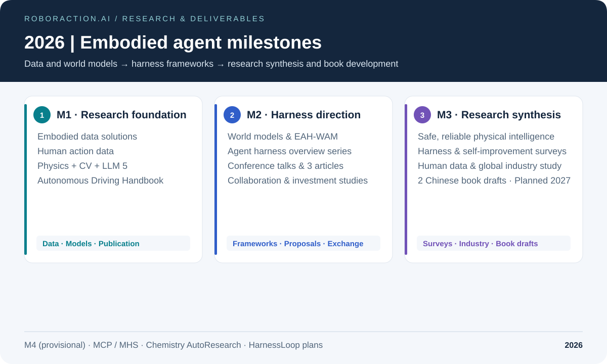

# 2026 · Work Report

[首页 / Home](README.md) · [2024](2024%20Work%20Summary.md) · [2025](2025%20Work%20Summary.md) · [2026](2026%20Work%20Summary.md)

> Data & models · Agent harnesses · Physical intelligence

## At a glance · 工作概览

| 方向 / Focus | 工作内容 / Scope |
| :--- | :--- |
| Milestone 1 | 具身数据、物理世界模型与英文专著 |
| Milestone 2 | Harness 框架、EAH-WAM、合作提案与投资调研 |
| Milestone 3 | 安全可靠物理智能、综述、行业调研与两部书稿 |
| Milestone 4 | MCP / MHS、化学自动研究与 HarnessLoop 计划（阶段性） |

> [!NOTE]
> 两部中文书稿计划于 2027 年出版，当前列为书稿成果。

## Contents · 导航

[Milestone 1](#milestone-1) · [Milestone 2](#milestone-2) · [Milestone 3](#milestone-3) · [Milestone 4 · 阶段性进展](#milestone-4)

---

## Milestone 1 · Data & models

**Milestone Summary:** Established a broader research foundation spanning embodied data, world models, and autonomous driving. Deliverables included the embodied intelligence data solutions presentation and its OS2ATC'26 conference version, an investigation of human action data, and continued study of world models incorporating physical laws through the Physics + CV + LLM series. The English-language Autonomous Driving Handbook, published by Springer and Tsinghua University Press in 2026, complemented these investigations with a systematic treatment of autonomous driving technologies. Together, these outputs connected data requirements, physical modeling, and autonomous systems knowledge as a foundation for subsequent embodied agent research.

**里程碑概述**：构建了涵盖具身数据、世界模型及自动驾驶的广泛研究基础。产出成果包括：关于具身智能数据解决方案的演示文稿（及其在 OS2ATC'26 会议上的版本）、针对人类动作数据的调研，以及通过“物理学 + 计算机视觉 + 大语言模型”（Physics + CV + LLM）系列研究，持续探索融合物理定律的世界模型。2026 年由施普林格（Springer）与清华大学出版社联合出版的英文版《自动驾驶手册》（Autonomous Driving Handbook），则从系统性视角对自动驾驶技术进行了全面阐述，与上述研究相辅相成。这些成果将数据需求、物理建模及自动驾驶系统知识有机串联，为后续的具身智能体（Embodied Agent）研究奠定了基础。

### 1.1 · "具身智能的数据解决方案" presentation (PDF) (part of it was presented in Beijing conference OS2ATC'26)：

- [具身智能的数据解决方案.pdf](2026doc/%E5%85%B7%E8%BA%AB%E6%99%BA%E8%83%BD%E7%9A%84%E6%95%B0%E6%8D%AE%E8%A7%A3%E5%86%B3%E6%96%B9%E6%A1%88.pdf)

- [具身智能的数据解决方案-OS2ATC26.pdf](2026doc/%E5%85%B7%E8%BA%AB%E6%99%BA%E8%83%BD%E7%9A%84%E6%95%B0%E6%8D%AE%E8%A7%A3%E5%86%B3%E6%96%B9%E6%A1%88-OS2ATC26.pdf)

### 1.2 · "人类动作数据" Investigation Report PPT：

- [人类动作数据.pdf](2026doc/%E4%BA%BA%E7%B1%BB%E5%8A%A8%E4%BD%9C%E6%95%B0%E6%8D%AE.pdf)

### 1.3 · Continued Investigation of World model with physical law "Physics + CV + LLM 5"

- [Physics +CV + LLM 5.pptx](2026doc/Physics%20%2BCV%20%2B%20LLM%205.pptx)

### 1.4 · English version of book "**Autonomous Driving Handbook**", Springer-Tsinghua, April, 2026

[Book · Springer](https://link.springer.com/book/10.1007/978-981-95-3725-9)

## Milestone 2 · Agent harness frameworks

**Milestone Summary:** Developed the research direction for embodied agent harnesses and their integration with world models and world action models. The work combined presentations for the Beijing M-robots OS Workshop and Shanghai WAIC'26 with three explanatory articles and overview series on AI Agent Harness and Embodied Agentic Harness. Research proposals outlined university collaboration to reproduce NVIDIA's ENPIRE method and investigate a WAM-based embodied agent harness, while an embodied AI investment review added market context. This milestone brought together framework studies, technical communication, collaboration planning, and commercial landscape research to define the next steps for embodied agent development.

**里程碑概述**：确立了具身智能体“驾驭”（Harness）的研究方向，并探索了其与世界模型及“世界动作模型”（World Action Models, WAM）的集成。相关工作包括在“北京 M-robots 操作系统研讨会”和“上海世界人工智能大会（WAIC'26）”上的专题报告，以及关于“人工智能体驾驭”（AI Agent Harness）和“具身智能体驾驭”（Embodied Agentic Harness）的系列综述文章。研究方案中提出了高校合作计划，旨在复现英伟达（NVIDIA）的 ENPIRE 方法，并探索基于 WAM 的具身智能体框架；同时，一份具身智能领域的投资分析报告进一步补充了市场背景。该里程碑整合了框架研究、技术交流、合作规划及商业格局分析，明确了具身智能体发展的后续路径。

### 2.1 · Beijing 开放原子生态大会 M-robots OS Workshop PPT “基于M-Robots 的世界模型智能体Harness 框架”：

- [2026开放原子生态大会 M-robots OS Workshop YHuang.pdf](2026doc/2026%E5%BC%80%E6%94%BE%E5%8E%9F%E5%AD%90%E7%94%9F%E6%80%81%E5%A4%A7%E4%BC%9A%20M-robots%20OS%20Workshop%20YHuang.pdf) 

### 2.2 · Shanghai WAIC'26 workshop PPT “世界动作模型具身智体驾驭EAH-WAM”：

- [世界动作模型具身智体驾驭EAH-WAM.pptx](2026doc/%E4%B8%96%E7%95%8C%E5%8A%A8%E4%BD%9C%E6%A8%A1%E5%9E%8B%E5%85%B7%E8%BA%AB%E6%99%BA%E4%BD%93%E9%A9%BE%E9%A9%ADEAH-WAM.pptx)

#### Related articles · 相关文章

Medium Poster: ["EAH-WAM: An World Action Model-based Embodied Agentic Harness"](https://yuhuang-63908.medium.com/eah-wam-an-world-action-model-based-embodied-agentic-harness-c3e75b59dc9e)

Three Harness posters：1）智能体Harness和具身机器人的碰撞； 2）将具身机器人扎根于LLM 智能体驾驭框架; 3）扩展到具身机器人的智体驾驭平台。

- [微信原文](https://mp.weixin.qq.com/s/06j2SyTP8CPTYzJXPYethw) — [PDF 备份：智能体Harness和具身机器人的碰撞](2026doc/%E6%99%BA%E8%83%BD%E4%BD%93Harness%E5%92%8C%E5%85%B7%E8%BA%AB%E6%9C%BA%E5%99%A8%E4%BA%BA%E7%9A%84%E7%A2%B0%E6%92%9E.pdf) 

- [微信原文](https://mp.weixin.qq.com/s/kES9v_7scwy4-PUwJCfkXg) — [PDF 备份：将具身机器人扎根于LLM 智能体驾驭框架](2026doc/%E5%B0%86%E5%85%B7%E8%BA%AB%E6%9C%BA%E5%99%A8%E4%BA%BA%E6%89%8E%E6%A0%B9%E4%BA%8ELLM%20%E6%99%BA%E8%83%BD%E4%BD%93%E9%A9%BE%E9%A9%AD%E6%A1%86%E6%9E%B6.pdf) 

- [微信原文](https://mp.weixin.qq.com/s/3E_fGOg9glqdUA_ToOWZ5w) — [PDF 备份：扩展到具身机器人的智体驾驭平台](2026doc/%E6%89%A9%E5%B1%95%E5%88%B0%E5%85%B7%E8%BA%AB%E6%9C%BA%E5%99%A8%E4%BA%BA%E7%9A%84%E6%99%BA%E4%BD%93%E9%A9%BE%E9%A9%AD%E5%B9%B3%E5%8F%B0.pdf) 

### 2.3 · University Collaboration Work proposal “复现NV的ENPIRE方法”：

- [复现NV的ENPIRE方法.docx](2026doc/%E5%A4%8D%E7%8E%B0NV%E7%9A%84ENPIRE%E6%96%B9%E6%B3%95.docx) 

### 2.4 · Embodied Agent Harness work proposal “具身WAM的Harness智能体”：

- [具身WAM的Harness智能体.docx](2026doc/%E5%85%B7%E8%BA%ABWAM%E7%9A%84Harness%E6%99%BA%E8%83%BD%E4%BD%93.docx) 

### 2.5 · Investment market of embodied AI/robot “Embodied AI Investment”：

- [Embodied AI Investment.pptx](2026doc/Embodied%20AI%20Investment.pptx) 

### 2.6 · Agent Harness work overview “AI Agent Harness 1/2/3”;

- [AI Agent Harness 1.pptx](2026doc/AI%20Agent%20Harness%201.pptx)

- [AI Agent Harness 2.pptx](2026doc/AI%20Agent%20Harness%202.pptx)

- [AI Agent Harness 3.pptx](2026doc/AI%20Agent%20Harness%203.pptx)

### 2.7 · Embodied Robotics Agent Harness work overview “Embodied Agentic Harness 1/2”.

- [Embodied Agentic Harness 1.pptx](2026doc/Embodied%20Agentic%20Harness%201.pptx)

- [Embodied Agentic Harness 2.pptx](2026doc/Embodied%20Agentic%20Harness%202.pptx)

## Milestone 3 · Research synthesis

**Milestone Summary:** Consolidated the research into a wider body of work on safe, reliable physical intelligence, agent harnesses, and recursive self-improvement. Deliverables included the GOSIM'26 Shenzhen presentation, a university-industry robotics collaboration proposal, two survey papers, and follow-up investigations of human action data. A global industry report reviewed leading robotics and embodied foundation model companies across VLA, world-model, and WAM approaches. Two Chinese book drafts, planned for publication by Electronic Industry Press in 2027, organized this knowledge into complementary treatments: one covering embodied intelligence from modular architectures to end-to-end models, and the other covering system platforms, harness engineering, and self-improvement. Their scope also included safety, multi-agent collaboration, benchmarks, evaluation, and scientific applications. Together, these outputs integrated technical surveys, industry analysis, collaboration planning, and book development into a coherent embodied intelligence research agenda.

**里程碑概述**：将既有研究整合为一套关于“安全可靠的物理智能”、“智能体驾驭”及“递归式自我提升”的综合研究体系。产出成果包括：GOSIM'26 深圳大会的演示文稿、一项产学研机器人合作提案、两篇综述论文，以及对人类动作数据的进一步深入调研。此外，一份全球行业报告梳理了机器人及具身基础模型领域的领先企业，涵盖了 VLA（视觉-语言-动作模型）、世界模型及 WAM 等技术路径。两部中文著作（计划于 2027 年由电子工业出版社出版）对上述知识进行了系统梳理：其中一部探讨从模块化架构到端到端模型的具身智能技术；另一部则聚焦于系统平台、驾驭工程及自我提升机制。这些内容还涵盖了安全性、多智能体协作、基准测试、评估体系以及科学应用等多个维度。这些产出共同将技术综述、行业分析、合作规划以及书籍编撰整合为一套连贯的具身智能研究议程。

### 3.1 · PPT for presentation "具身智能体驾驭：从大模型到安全、可靠的物理智能" at GOSIM' 26 Shenzhen：

- [黄浴 开放机器人EAH.pptx](2026doc/%E9%BB%84%E6%B5%B4%20%E5%BC%80%E6%94%BE%E6%9C%BA%E5%99%A8%E4%BA%BAEAH.pptx) 

### 3.2 · The work proposal "机器人合作研究计划" for research collaboration：

- [高校公司机器人合作研究计划.pdf](2026doc/%E9%AB%98%E6%A0%A1%E5%85%AC%E5%8F%B8%E6%9C%BA%E5%99%A8%E4%BA%BA%E5%90%88%E4%BD%9C%E7%A0%94%E7%A9%B6%E8%AE%A1%E5%88%92.pdf) 

### 3.4 · A survey paper "Embodied Agentic Harnesses for Physical Intelligence: A Survey":

[Paper · engrXiv](https://engrxiv.org/preprint/view/8297)

### 3.5 · A review paper "Recursive Self Improvement for Embodied Agents—A Survey of Foundations Mechanisms Harnesses and Evaluation":

[Paper · Preprints.org](https://www.preprints.org/manuscript/202610.2080)

知乎：["具身智能体RSI技术综述"](https://zhuanlan.zhihu.com/p/2097787597846328441)

### 3.6 · Continued Investigation Report "人类动作数据 2/3“ PPT：

- [人类动作数据 2.pdf](2026doc/%E4%BA%BA%E7%B1%BB%E5%8A%A8%E4%BD%9C%E6%95%B0%E6%8D%AE%202.pdf)

- [人类动作数据 3.pdf](2026doc/%E4%BA%BA%E7%B1%BB%E5%8A%A8%E4%BD%9C%E6%95%B0%E6%8D%AE%203.pdf)

### 3.7 · “2026全球机器人与具身智能基础模型调研总结报告”

- [2026全球机器人与具身智能基础模型（VLA_世界模型_WAM）Tier-1企业调研总结报告.pdf](2026doc/2026%E5%85%A8%E7%90%83%E6%9C%BA%E5%99%A8%E4%BA%BA%E4%B8%8E%E5%85%B7%E8%BA%AB%E6%99%BA%E8%83%BD%E5%9F%BA%E7%A1%80%E6%A8%A1%E5%9E%8B%EF%BC%88VLA_%E4%B8%96%E7%95%8C%E6%A8%A1%E5%9E%8B_WAM%EF%BC%89Tier-1%E4%BC%81%E4%B8%9A%E8%B0%83%E7%A0%94%E6%80%BB%E7%BB%93%E6%8A%A5%E5%91%8A.pdf)

### 3.8 · Drafted version of the book 《具身智能 - 从模块化结构到端到端模型》 and the book 《具身智能 — 从系统平台到智能体驾驭与自我改进》 in Chinese （Electronic Industry Press）

To be published in 2027

书稿目录 / Book contents · 《具身智能---从模块化结构到端到端模型》

前言

1. 具身智能概论

2. 具身智能的基础理论

3. 具身智能的大模型方法

4. 具身智能的数据采集和生成

5. 具身感知

6. 空间智能

7. 具身导航

8. 具身规划

9. 具身控制

10. 具身世界模型

11. 具身智能的视觉-语言-动作模型

12. 基于人类数据的机器人学习

书稿目录 / Book contents · 《具身智能——从系统平台到智能体驾驭与自我改进》

前言

1. 具身智能的硬件系统

2. 具身智能的软件系统

3. AI智体的基础框架

4. AI智体的驾驭（Harness）工程

5. AI智体的递归自改进（RSI）

6. 具身智能的安全性

7. 具身多智体协同系统

8. 具身智能的基准和评估

9. 具身智体机器人的驾驭（Harness）工程

10. 具身智体机器人的递归自改进（RSI）

11. 具身智能在科研中的应用-机器人化学家

## Milestone 4

**Milestone Summary (provisional; items 4.1–4.3):** Extended embodied agent harness research toward scientific automation and closed-loop robot learning through three initial deliverables. An MCP and MHS introduction documented the interface concepts. The Chemistry AutoResearch proposal outlined automated quantitative liquid dispensing with ADORA_2_MAX, combining MCP, MHS, a System 1/System 2 design, and an embodied harness loop. The bilingual HarnessLoop project plan proposed physics-engine and Gaussian-splatting simulation data generation for on-the-fly robot training in a closed loop. These outputs define initial architecture and project plans; implementation and experimental validation remain outside the outcomes documented here. This summary will be expanded as further milestone work is added.

**里程碑概述（暂定，涵盖 4.1–4.3）：** 本阶段将具身智能体驾驭研究延伸至科研自动化与闭环机器人学习。现有成果包括 MCP 与 MHS 介绍、基于 ADORA_2_MAX 的自动化定量加液实验项目提案，以及中英文 HarnessLoop 项目计划。化学自动研究方案结合 MCP、MHS、系统 1/系统 2 设计与具身 Harness 闭环；HarnessLoop 规划利用物理引擎和高斯泼溅生成仿真数据，支持闭环中的即时机器人训练。目前成果为接口研究、架构设计及项目规划，尚不代表完成系统实现或实验验证；后续将随新增工作继续更新。

### 4.1 · Agentic MCP (Model Context Protocol) and Embodied MHS (Model Hardware Standard)：

- [MCP和MHS介绍.pdf](2026doc/MCP%E5%92%8CMHS.pdf)

- 知乎文章：["Anthropic 模型硬件标准 （MHS）总结"](https://zhuanlan.zhihu.com/p/2098201895261283231)

- 知乎文章：["Pharma Labs采取的Anthropic 模型硬件需求"](https://zhuanlan.zhihu.com/p/2098210161534019190)

- 知乎文章：["模型硬件标准（MHS）解析：MHS 如何助力 AI 智能体安全地操控物理设备"](https://zhuanlan.zhihu.com/p/2098371394992091182)

### 4.2 · Chemistry AutoResearch Project Proposal/项目提议:

**Note**: Based on MCP, MHS, Dual-System Design (System 1/2) and Embodied Harness Loop

- [ADORA_2_MAX_自动化定量加液实验工作设计.pdf](2026doc/ADORA_2_MAX_自动化定量加液实验工作设计_V6%20HY.pdf)
 
### 4.3 · HarnessLoop Project Plan/项目计划：

**Note**: Physics Engine and Gaussian Splatting based Simulation Data Generation for On-the-fly Agentic Robot Training in a Closed Loop

- [Chinese.pdf](2026doc/HarnessLoop_%E9%A1%B9%E7%9B%AE%E8%AE%A1%E5%88%92_%E4%B8%AD%E6%96%87%20v5.pdf)

- [English.pdf](2026doc/HarnessLoop_Project_Plan_English%20v5.pdf)

### 4.4 · “An Overview of Emerging Technologies of Autonomous Driving“

**Note**: Chapter 12 in the Book "**Frontiers in Visual Computing, Deep Learning, and Multimedia - Gedenkschrift for Prof Thomas S Huang**", pp381-426, published by World Scientific Company, Oct. 2026. 

[Book · World Scientific](https://www.worldscientific.com/worldscibooks/10.1142/14904#t=aboutBook)

- [Chapter 12.pdf](2026doc/Chapter%2012%20Yu%20Huang%20et%20al.pdf)

### 4.5 · “Research Proposal of Physics Constraint Embodied AI for Long Horizon Execution, Agentic Harness and Recursive Self-Improvement“ 

**Note**: Mathematical Foundations of Long-Horizon Execution, Agentic Harness and Recursive Self-Improvement for Embodied AI under Physical Constraints

- to be continued......

---

[↑ Back to top](#2026--work-report) · [首页 / Home](README.md) · [2024](2024%20Work%20Summary.md) · [2025](2025%20Work%20Summary.md) · [2026](2026%20Work%20Summary.md)
