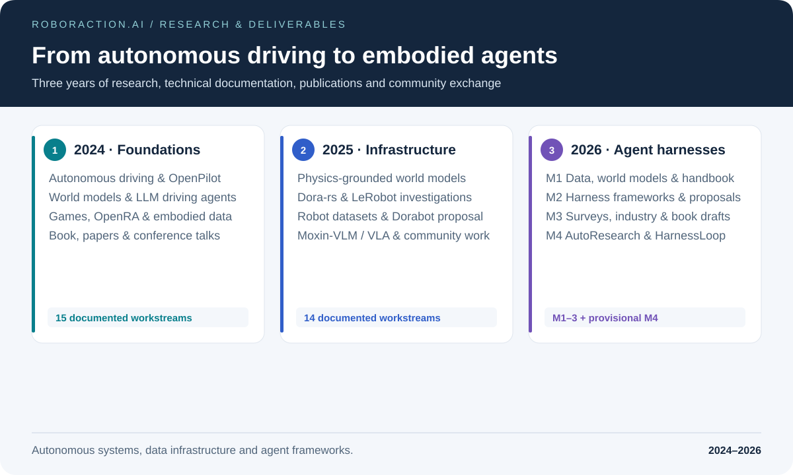

# Roboraction.AI · Research & Deliverables

**2024—2026 工作报告 / Annual research reports**

From autonomous driving and AI agents to embodied data infrastructure, agent harnesses and physical intelligence.

## Explore the reports · 年度导航

| 年度 | 研究重点 | 报告入口 |
| :--- | :--- | :--- |
| **2024** | 自动驾驶 · LLM 与智能体 · 应用与数据 | [15 个工作条目 →](2024%20Work%20Summary.md) |
| **2025** | 世界模型 · Dora-rs / LeRobot · 具身数据基础 | [14 个工作条目 →](2025%20Work%20Summary.md) |
| **2026** | 数据与模型 · Harness · 综述、产业研究与书稿 | [Milestones 1–3 →](2026%20Work%20Summary.md) |

> [!NOTE]
> **2026 ** 中文书稿计划于 2027 年出版，详见年度报告。

---

## 2024 · Annual report

[查看完整报告 / Read the full report](2024%20Work%20Summary.md)

The 2024 work connected autonomous driving research with an expanding focus on large language models, AI agents, and embodied intelligence. Autonomous driving deliverables included the WACV LLVM-AD keynote, the co-authored book 自动驾驶系统开发 (Autonomous Driving System Development), and technical studies of OpenPilot development and deployment pathways, dataset formats, depth-based driving, and sensor fusion. LLM and agent research covered mixture-of-experts models, model merging, tool use and function calling, agent architectures, application platforms, and AI devices, alongside the paper on levels of AI agents and contributions to the Moxin open-source language model research. Application-oriented investigations explored LLM agents in games and OpenRA, while embodied AI work examined data challenges, vision-language-action models, and annotation tools. Presentations and materials for WACV, MIPR, and GOSIM, together with CoRL conference notes, complemented the publications and technical reports. Collectively, these deliverables established a research and knowledge-sharing foundation spanning autonomous systems, agent capabilities, open-source AI, and the data requirements of embodied intelligence.

2024 年的工作将自动驾驶研究与大语言模型、AI 智能体（AI Agents）及具身智能（Embodied Intelligence）等日益受到关注的领域紧密结合。在自动驾驶方面，相关成果包括：在 WACV 会议上发表的“LLVM-AD”主题演讲；合著书籍《自动驾驶系统开发》；以及针对 OpenPilot 开发与部署路径、数据集格式、基于深度信息的驾驶技术，以及传感器融合技术所开展的各项研究。在大语言模型与智能体领域，研究涵盖了专家混合模型（MoE）、模型融合、工具使用与函数调用、智能体架构、应用平台及 AI 硬件设备；此外还包括关于 AI 智能体分级体系的论文，以及对“墨芯”（Moxin）开源语言模型研究的贡献。在应用导向的研究方面，团队探索了大语言模型智能体在游戏（如 OpenRA）中的应用；在具身智能领域，则重点探讨了数据挑战、视觉-语言-动作（VLA）模型以及标注工具。此外，在 WACV、MIPR 和 GOSIM 会议上的演讲与相关资料，以及 CoRL 会议的参会笔记，进一步丰富了上述研究成果与技术报告的内容。这些工作共同构建了一个涵盖自动驾驶系统、智能体能力、开源 AI 以及具身智能数据需求的研究与知识共享基础。

## 2025 · Annual report

[查看完整报告 / Read the full report](2025%20Work%20Summary.md)

In 2025, the work built the research, data and middleware foundation for embodied AI, and established a public presence for it in the open-source and research communities.

Research investigations covered three directions: physics-grounded world models (about 40 papers), inference-time scaling laws for large language models, and embodied AI itself, with studies of robot skill learning methods and of generalization in robot policy learning. On the engineering side, the work analyzed two open-source robotics stacks: the Dora-rs middleware, and Hugging Face’s LeRobot, documented in an eight-part series covering its dataset management, robot control, environment interface and policy systems, a development guide, and hands-on setup of the SO100 and SO101 arms. This fed into a project proposal for the Dorabot embodied AI data platform and a report on dataset construction for robot foundation model training based on NVIDIA’s GR00T work.

The results were presented in four talks: a keynote at OS2ATC’25 in Beijing, the Open Atom Foundation conferences in Changsha and Chongqing, and COSCon’25 in Beijing. An industry innovation forum on embodied AI was also organized at IEEE MIPR’25 in San Jose, and a 17-chapter book on embodied AI was drafted for publication in 2027.

2025年，工作围绕具身智能（Embodied AI）的研究、数据与中间件基础展开，并在开源及学术研究社区中推广这些成果。

调研工作涵盖三个方向：基于物理规律的世界模型（约40篇论文）、大模型推理时间的规模化定律，以及具身智能本身，包括机器人技能学习方法和机器人策略学习的泛化方法。工程方面，分析了两套开源机器人软件栈：Dora-rs中间件，以及Hugging Face的LeRobot。后者形成八份系列文档，涵盖数据集管理、机器人控制、环境接口和策略系统、开发指南，以及SO100和SO101机械臂的安装与使用。在此基础上，完成了Dorabot具身智能数据平台的项目提案，以及一份基于NVIDIA GR00T工作的机器人基础模型训练数据集构建报告。

这些成果通过四场演讲对外发布：北京OS2ATC’25的主旨演讲、开放原子开源基金会在长沙和重庆的两场会议，以及北京的COSCon’25。此外，在圣何塞IEEE MIPR’25上组织了具身智能产业创新论坛，并完成了一本17章的具身智能专著书稿，计划于2027年出版。

## 2026 · Annual report

[查看完整报告 / Read the full report](2026%20Work%20Summary.md)

### Milestone 1

 Established a broader research foundation spanning embodied data, world models, and autonomous driving. Deliverables included the embodied intelligence data solutions presentation and its OS2ATC'26 conference version, an investigation of human action data, and continued study of world models incorporating physical laws through the Physics + CV + LLM series. The English-language Autonomous Driving Handbook, published by Springer and Tsinghua University Press in 2026, complemented these investigations with a systematic treatment of autonomous driving technologies. Together, these outputs connected data requirements, physical modeling, and autonomous systems knowledge as a foundation for subsequent embodied agent research.

**里程碑 1 概述**：构建了涵盖具身数据、世界模型及自动驾驶的广泛研究基础。产出成果包括：关于具身智能数据解决方案的演示文稿（及其在 OS2ATC'26 会议上的版本）、针对人类动作数据的调研，以及通过“物理学 + 计算机视觉 + 大语言模型”（Physics + CV + LLM）系列研究，持续探索融合物理定律的世界模型。2026 年由施普林格（Springer）与清华大学出版社联合出版的英文版《自动驾驶手册》（Autonomous Driving Handbook），则从系统性视角对自动驾驶技术进行了全面阐述，与上述研究相辅相成。这些成果将数据需求、物理建模及自动驾驶系统知识有机串联，为后续的具身智能体（Embodied Agent）研究奠定了基础。

### Milestone 2

 Developed the research direction for embodied agent harnesses and their integration with world models and world action models. The work combined presentations for the Beijing M-robots OS Workshop and Shanghai WAIC'26 with three explanatory articles and overview series on AI Agent Harness and Embodied Agentic Harness. Research proposals outlined university collaboration to reproduce NVIDIA's ENPIRE method and investigate a WAM-based embodied agent harness, while an embodied AI investment review added market context. This milestone brought together framework studies, technical communication, collaboration planning, and commercial landscape research to define the next steps for embodied agent development.

**里程碑 2 概述**：确立了具身智能体“驾驭”（Harness）的研究方向，并探索了其与世界模型及“世界动作模型”（World Action Models, WAM）的集成。相关工作包括在“北京 M-robots 操作系统研讨会”和“上海世界人工智能大会（WAIC'26）”上的专题报告，以及关于“人工智能体驾驭”（AI Agent Harness）和“具身智能体驾驭”（Embodied Agentic Harness）的系列综述文章。研究方案中提出了高校合作计划，旨在复现英伟达（NVIDIA）的 ENPIRE 方法，并探索基于 WAM 的具身智能体框架；同时，一份具身智能领域的投资分析报告进一步补充了市场背景。该里程碑整合了框架研究、技术交流、合作规划及商业格局分析，明确了具身智能体发展的后续路径。

### Milestone 3

 Consolidated the research into a wider body of work on safe, reliable physical intelligence, agent harnesses, and recursive self-improvement. Deliverables included the GOSIM'26 Shenzhen presentation, a university-industry robotics collaboration proposal, two survey papers, and follow-up investigations of human action data. A global industry report reviewed leading robotics and embodied foundation model companies across VLA, world-model, and WAM approaches. Two Chinese book drafts, planned for publication by Electronic Industry Press in 2027, organized this knowledge into complementary treatments: one covering embodied intelligence from modular architectures to end-to-end models, and the other covering system platforms, harness engineering, and self-improvement. Their scope also included safety, multi-agent collaboration, benchmarks, evaluation, and scientific applications. Together, these outputs integrated technical surveys, industry analysis, collaboration planning, and book development into a coherent embodied intelligence research agenda.

**里程碑 3 概述**：将既有研究整合为一套关于“安全可靠的物理智能”、“智能体驾驭”及“递归式自我提升”的综合研究体系。产出成果包括：GOSIM'26 深圳大会的演示文稿、一项产学研机器人合作提案、两篇综述论文，以及对人类动作数据的进一步深入调研。此外，一份全球行业报告梳理了机器人及具身基础模型领域的领先企业，涵盖了 VLA（视觉-语言-动作模型）、世界模型及 WAM 等技术路径。两部中文著作（计划于 2027 年由电子工业出版社出版）对上述知识进行了系统梳理：其中一部探讨从模块化架构到端到端模型的具身智能技术；另一部则聚焦于系统平台、驾驭工程及自我提升机制。这些内容还涵盖了安全性、多智能体协作、基准测试、评估体系以及科学应用等多个维度。这些产出共同将技术综述、行业分析、合作规划以及书籍编撰整合为一套连贯的具身智能研究议程。

### Milestone 4

---

[首页 / Home](README.md) · [2024](2024%20Work%20Summary.md) · [2025](2025%20Work%20Summary.md) · [2026](2026%20Work%20Summary.md)
